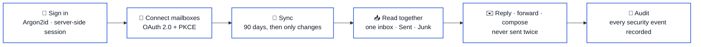
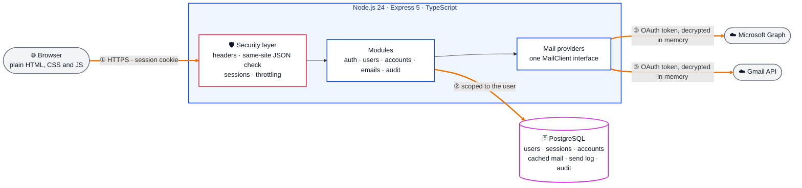

# Mailbridge

> **Outlook and Gmail in one inbox.** A security-focused web app that connects any number of Microsoft and Google mailboxes and reads them together. It is built on **Node.js 24**, **Express 5**, **strict TypeScript** and **PostgreSQL**, with Argon2id passwords, server-side sessions, encrypted OAuth tokens, an insert-only audit trail and a contract-first API. Every change passes unit, integration, browser and mutation tests in a 13-job CI pipeline. It is the application deployed and attacked in [Secure Mailbridge Lab](https://github.com/marko-spasovski/secure-mailbridge-lab).

[](https://github.com/marko-spasovski/secure-mailbridge-app/actions/workflows/ci.yml)
[](https://github.com/marko-spasovski/secure-mailbridge-app/actions/workflows/codeql.yml)


---

## Table of contents

- [Overview](#overview)
- [Screenshots](#screenshots)
- [Architecture](#architecture)
- [Tech stack](#tech-stack)
- [Project status](#project-status)
- [Repository layout](#repository-layout)
- [Getting started](#getting-started)
- [Connecting real mailboxes](#connecting-real-mailboxes)
- [Configuration](#configuration)
- [Security](#security)
- [Testing](#testing)
- [CI quality gates](#ci-quality-gates)
- [Deployment](#deployment)
- [Documentation](#documentation)
- [Author](#author)
- [License](#license)

---

## Overview

Mailbridge answers one question: **can you read and answer mail from several Outlook and Gmail accounts in one place, without giving up security?**



- **One inbox for every account.** Mail from all connected Outlook and Gmail accounts appears in a single list, colour-coded by mailbox, with per-account views, an unread filter, search and sorting.
- **Inbox, Sent and Junk.** Each folder combines every account, like the inbox. Sent mail is listed by recipient; junk mail opens with a warning, and its images stay off like everywhere else.
- **Read mail safely.** Message bodies render in a sandboxed frame that cannot run scripts, and remote images stay off until you ask for them.
- **Reply, forward and compose** from any connected account. Read state is written back to the provider, so Outlook and Gmail stay in step.
- **Attachments and export.** Download attachments, or save any message as an `.eml` file.
- **Accounts and profile.** Sign up, sign in, reset a forgotten password by email, change your name and photo, and switch between light and dark themes.
- **Recent activity.** Settings lists the sign-ins, password changes, mailbox connections and sends on your account, with time, device and address, so anything that was not you stands out.
- **Works without any setup.** A seeded demo user with two demo mailboxes lets you try the whole interface before registering an OAuth app.

---

## Screenshots

| Light | Dark |
| --- | --- |
|  |  |
|  |  |

<p align="center">
  
  &nbsp;&nbsp;
  
</p>

These pictures are produced by the browser tests, so they always show the current interface. To refresh them:

```sh
SCREENSHOT_DIR=docs/screenshots npm run test:e2e
```

---

## Architecture

### Request path

[`docs/architecture.md`](docs/architecture.md) is the source of truth, and the decisions behind it are in [`docs/adr/`](docs/adr/).



**How to read it**

| Element | Meaning |
|---|---|
| 🟧 thick orange arrows ①–③ | the request path, from the browser to the database and the mail providers |
| 🟥 red box | the security layer every request passes before any module runs |
| 🟦 blue boxes | the application modules and the provider interface |
| 🟣 cylinder | PostgreSQL: the only state the app keeps |
| grey shapes | the browser and the two external mail APIs |

**Request path, step by step**

1. The browser sends a same-site JSON request with the `HttpOnly` session cookie. The security layer sets the headers, refuses cross-site or non-JSON writes, loads the session and applies throttling.
2. The module validates the input with a strict Zod schema and reads or writes PostgreSQL. Every query is scoped to the signed-in user, so another person's data answers `404`.
3. To sync or send, the provider client decrypts the account's OAuth token in memory (AES-256-GCM) and calls Microsoft Graph or the Gmail API. Tokens never reach the browser.

**Design principles**

- **No front-end build step.** The interface is hand-written HTML, CSS and JavaScript served as static files.
- **One provider interface.** Outlook and Gmail each implement the same small `MailClient` contract (sync, body, attachments, send, mark read), so the rest of the app never asks which provider it is talking to.
- **Incremental sync.** The first sync loads the last 90 days of the Inbox, Sent and Junk folders. After that, only changes are fetched: Graph delta links for Outlook and history IDs for Gmail. An expired checkpoint rebuilds itself.
- **Gmail quota aware.** Gmail allows 6,000 quota units per mailbox per minute. The client budgets its requests, and when Google reports the minute is used up it waits for the next one instead of failing.
- **Sends are never duplicated.** Every send carries a request ID that is recorded before the provider is called. A retry of an accepted request is answered from the record, and an uncertain outcome is reported as uncertain rather than retried.
- **No database lock waits on the network.** A sync claims its account with a short lease, and token refreshes are saved with compare-and-swap, so a slow provider never ties up a database connection.
- **Fast at any size.** The inbox pages by cursor (keyset), straight from an index in inbox order, and search uses full-text and trigram indexes. On 100,000 saved messages, a page takes under a millisecond and a search under 25 ms.
- **One contract.** [`contracts/openapi.yaml`](contracts/openapi.yaml) describes every endpoint; requests are validated with Zod against the same rules, and every error has a stable `code`.

---

## Tech stack

| Layer | Tool | Role in the app |
|---|---|---|
| Runtime | **Node.js 24**, **Express 5**, **TypeScript** (strict) | HTTP server, modules, provider clients |
| Validation | **Zod** | strict schemas for every body, query and path parameter |
| Database | **PostgreSQL 18** | users, sessions, accounts, cached mail, send log, insert-only audit trail |
| Passwords | **Argon2id** (128 MiB, 3 passes) | password hashing |
| Mail providers | **Microsoft Graph**, **Gmail API** | OAuth 2.0 + PKCE, incremental sync, send |
| Front end | plain **HTML, CSS, JavaScript** with JSDoc types | no build step, sandboxed message frame, light and dark themes |
| API contract | **OpenAPI** + **Redocly** | single source of truth for every endpoint and error code |
| Tests | Node's built-in test runner, **Playwright** (Chromium + Firefox), mutation script | unit, integration, browser and mutation tests |
| Lint and format | **Biome** | linting and formatting |
| Containers | **Docker** (non-root, read-only), **Docker Compose**, **Caddy** | local stack and single-host production with automatic HTTPS |
| CI/CD | **GitHub Actions**, CodeQL, Semgrep, Trivy, gitleaks, actionlint, Dependabot, GHCR | quality gates, signed image publishing, releases |

---

## Project status

**Current state:** feature-complete for a single-user and small-team inbox, with every CI gate green. It is also deployed behind OpenVPN, Suricata, ModSecurity and Wazuh in [Secure Mailbridge Lab](https://github.com/marko-spasovski/secure-mailbridge-lab).

| Component | Status |
|---|---|
| Unified inbox, Sent and Junk across Outlook and Gmail | ✅ done |
| Reply, forward, compose, attachments, `.eml` export | ✅ done |
| Accounts: sign-up, sign-in, password reset, profile, themes | ✅ done |
| Security: Argon2id, sessions, same-site JSON, throttling, encrypted tokens, audit trail | ✅ done; mapped to the OWASP Top 10 in [SECURITY.md](SECURITY.md) |
| Tests: unit, integration, browser (2 engines), mutation; coverage enforced | ✅ done (95% lines · 87% branches · 92% functions) |
| CI: 13 jobs + CodeQL + Dependabot; signed image publishing | ✅ done |
| Production: Docker Compose + Caddy; AWS lab deployment | ✅ documented in [docs/deployment.md](docs/deployment.md) |
| Gmail for the public (Google app verification) | ⬜ not planned; test users only |

---

## Repository layout

```text
secure-mailbridge-app/
├── src/
│   ├── app.ts, server.ts      # Express wiring and startup
│   ├── config/                # configuration schema, database pool, logger
│   ├── http/                  # error codes and input validation
│   ├── middleware/            # security headers, same-site check, sessions, throttling, errors
│   ├── modules/
│   │   ├── auth/              # sign-in, registration, password reset
│   │   ├── audit/             # the security event log
│   │   ├── users/             # profile and photo
│   │   ├── accounts/          # connected mailboxes and the OAuth callback
│   │   └── emails/            # listing, reading, sending, export, HTML sanitizing
│   ├── integrations/
│   │   ├── mail/              # the provider contract shared by both mail services
│   │   └── gmail/, outlook/   # the two implementations
│   ├── security/              # password hashing and credential encryption
│   └── scripts/               # migrations, demo data, admin tools
├── public/                    # the interface: HTML, CSS, JavaScript, icons
├── types/                     # type declarations for the browser scripts
├── contracts/                 # the OpenAPI contract
├── database/migrations/       # SQL migrations
├── tests/                     # unit tests, plus integration/, e2e/, mutation/ and support/
├── deploy/                    # Caddy config, database roles, backup and smoke-test scripts
├── docs/                      # architecture, decisions (adr/), runbooks, analysis
└── .github/workflows/         # CI and CodeQL
```

---

## Getting started

> [!NOTE]
> You need **Node.js 24** and **Docker**. Nothing here sends mail to real inboxes: password resets are caught by Mailpit, and the demo mailboxes work without any OAuth app.

```sh
# 1. Install and configure
npm ci
cp .env-example .env

# 2. Start PostgreSQL, create the schema and load demo data
docker compose up -d postgres
npm run migration
npm run seed        # demo user demo@example.test / Demo-Password-123! with two demo mailboxes

# 3. Run it
npm run dev         # http://localhost:3000
```

- Without OAuth credentials the demo mailboxes still work; the Connect buttons stay disabled until a provider is configured.
- Password reset emails are caught by Mailpit: run `docker compose up -d mailpit` and read them at http://localhost:8025. With `SMTP_HOST` empty, reset links are printed to the server log instead (development only).
- To browse the database, run `docker compose up -d pgadmin` and open http://localhost:5050. Sign in with `PGADMIN_DEFAULT_EMAIL` / `PGADMIN_DEFAULT_PASSWORD` from `.env`; the Mailbridge server is already listed and asks for `POSTGRES_PASSWORD`.

---

## Connecting real mailboxes

Register an app with each provider and set the redirect URIs:

| Provider | Redirect URI | Env vars | Scopes |
| --- | --- | --- | --- |
| Microsoft (Entra app registration) | `<PUBLIC_ORIGIN>/accounts/callback/outlook` | `MICROSOFT_CLIENT_ID`, `MICROSOFT_CLIENT_SECRET`, `MICROSOFT_TENANT` | `User.Read Mail.ReadWrite Mail.Send offline_access` |
| Google (Cloud console, OAuth client "Web") | `<PUBLIC_ORIGIN>/accounts/callback/gmail` | `GOOGLE_CLIENT_ID`, `GOOGLE_CLIENT_SECRET` | Gmail API: `gmail.modify` and `gmail.send` |

- `MICROSOFT_TENANT` must match the app registration's supported account types: `common` for work, school and personal accounts, `consumers` for personal accounts only, or a tenant ID for one organisation.
- `GMAIL_ALLOWED_EMAILS=a@x.com,b@y.com` limits the Gmail option to those app users, which fits an unverified Google app limited to test users. Outlook stays open to everyone.
- Gmail's mail scopes are *restricted*. While the Google app is in "Testing", only listed test users can connect and tokens expire after 7 days; public use needs Google's verification.
- A large Gmail inbox syncs at roughly 270 messages per minute because of Google's per-mailbox quota.
- Gmail forwards do not include the original attachments.
- Migration `008_unified_mailboxes.sql` replaces the old ticket schema and **deletes previously cached emails** (they are re-synced from the provider). It is not reversible.

---

## Configuration

All settings are environment variables; see [.env-example](.env-example) for development, [.env.production.example](.env.production.example) for the Caddy setup and [.env.example](.env.example) for every variable with its format (used by the [AWS lab deployment](docs/deployment.md)).

| Variable | Purpose |
| --- | --- |
| `PUBLIC_ORIGIN` | Public address of the app. Required in production, where it must be HTTPS. |
| `SESSION_SECRET`, `TOKEN_ENCRYPTION_KEY` | Sign sessions and encrypt stored mailbox credentials. At least 32 characters each and different from each other in production. |
| `TOKEN_ENCRYPTION_KEY_PREVIOUS` | Only while rotating the encryption key; see [the runbook](docs/runbooks/key-rotation.md). |
| `TRUST_PROXY` | How many reverse proxies may set `X-Forwarded-For` / `X-Forwarded-Proto` (`1` behind Caddy or Nginx). Decides the client IP used by throttling, logs and the audit trail, and lets the Secure session cookie be set. Production requires at least `1`. |
| `LOG_LEVEL` | `info` by default; `debug`, `warn`, `error` or `silent`. |
| `ALLOW_REGISTRATION` | Set to `false` to stop new sign-ups. |
| `MICROSOFT_*`, `GOOGLE_*` | OAuth app credentials. A provider without them is simply not offered. |
| `GMAIL_ALLOWED_EMAILS` | Optional invite list for the Gmail option. |
| `SMTP_*` | Outgoing mail for password resets. |
| `POSTGRES_*` | Database connection. `POSTGRES_SSL=true` turns on TLS with full certificate verification; `POSTGRES_SSL_CA` takes the PEM of a private CA. |
| `PGADMIN_*` | Local pgAdmin sign-in and port (development only). |

---

## Security

| Area | What is done |
| --- | --- |
| Passwords | Argon2id (128 MiB, 3 passes). Reset tokens are single-use, expire after 30 minutes, are stored only as a hash and travel in the URL fragment. |
| Sessions | Server-side sessions in PostgreSQL. The cookie is `HttpOnly`, `SameSite=Lax`, and in production `Secure` with the `__Host-` prefix. The session ID is replaced on sign-in, a session ends after 8 idle hours and at most 7 days after sign-in, and changing or resetting a password signs out every session. |
| Request forgery | Every state-changing request must be same-site `application/json`; cross-site and foreign-origin requests are refused. |
| Brute force | Sign-in, registration and reset attempts are counted per address and per account, and password changes and sends per signed-in person. An unknown address is refused as slowly as a wrong password. Counter keys are HMAC-hashed, so the table stores no email or IP addresses. |
| OAuth | Authorization code flow with PKCE and a single-use `state`, compared in constant time. Tokens are encrypted with AES-256-GCM, bound to their account row, and never reach the browser. The encryption key can be rotated without anyone reconnecting ([runbook](docs/runbooks/key-rotation.md)). |
| Input | Every request body, query and path parameter is checked by a Zod schema; bodies are strict, so unknown fields are refused. |
| Mail content | HTML is sanitized and shown in a sandboxed frame under its own Content-Security-Policy. Sync cursors are validated so a stored URL can never send a token to another host. |
| Data isolation | Every query is scoped to the signed-in user. Another person's mail and accounts answer `404`. |
| Audit trail | Sign-ins and failures, password changes and resets, mailbox connections, sends, downloads and refused requests are recorded with time, IP address, browser and request ID, and kept for 90 days. The log never holds mail content, recipients, passwords or tokens, and an attempt on an unknown address is stored without the address. The database itself refuses to change or truncate audit rows, and the app can run as a role that cannot switch that guard off ([`deploy/db-roles.sql`](deploy/db-roles.sql)). |
| Logs | One JSON line per request with a request ID, path (never the query string), status, user and client IP. Cookies, passwords and tokens are redacted, and error messages are never logged. |
| Headers | Strict Content-Security-Policy, `X-Frame-Options: DENY`, `nosniff`, `no-referrer`, and HSTS in production. |
| Container | Runs as a non-root user on a read-only filesystem with all capabilities dropped. |

Each row above is exercised by the test suite described under [Testing](#testing). [SECURITY.md](SECURITY.md) maps these protections to the OWASP Top 10, lists the known limits and says how to report a problem.

---

## Testing

Everything runs on Node's built-in test runner with no extra test framework.

| Layer | Command | Needs | What it covers |
| --- | --- | --- | --- |
| Unit | `npm test` | nothing | Gmail and Outlook clients against recorded responses, quota budgeting, cursor validation, MIME handling, HTML sanitizing, credential encryption and key rotation, validation rules, configuration rules |
| Integration | `npm run test:integration` | PostgreSQL | The real app over HTTP against a real database. Driven by the contract: every endpoint answers `401` without a session, `404` for another person's data and `400` with the failing fields for invalid input. Also sessions, throttling, password reset, OAuth, sync leases, send idempotency, search, paging, logs, the audit guard and the least-privilege database role |
| Browser | `npm run test:e2e` and `npm run test:e2e:firefox` | PostgreSQL, Chromium/Firefox | Sign-in, the inbox, Sent and Junk, reading, filters, search, paging, settings, sign-out, keyboard-only use, Back after sign-out, and no sideways scrolling at phone width. Any console error or Content-Security-Policy violation fails the test |
| Mutation | `npm run test:mutation` | PostgreSQL | Plants 22 deliberate bugs in security- and logic-critical code, one at a time, and requires the tests to catch each one ([tests/mutation](tests/mutation)) |

```sh
npm run check            # lint, typecheck (source, tests, browser scripts), unit tests, build
npm run test:coverage    # unit + integration with coverage thresholds
npm run test:all         # unit, integration and both browsers
npx playwright install chromium firefox   # once, before the first browser run
```

- **A separate database.** Integration and browser tests use `<POSTGRES_DB>_test`, created and migrated automatically, so they never touch development data.
- **No network.** Google and Microsoft are replaced by in-process stand-ins; an unexpected outbound request fails the test.
- **Coverage is enforced.** `test:coverage` fails below 90% of lines, 75% of branches or 85% of functions. It currently reports 95%, 87% and 92%.
- **Migrations are tested both ways.** CI rolls back every migration after 008 and applies it again (`npm run migration -- down <n>`).

---

## CI quality gates

Every pull request and every push to `main` runs [`.github/workflows/ci.yml`](.github/workflows/ci.yml). Every action is pinned to a commit SHA and every image to a digest.

| Job | What it checks |
| --- | --- |
| Lint, types, unit tests, build | Biome, strict TypeScript over source, tests and browser scripts, the unit suite, and a production build |
| Integration tests and coverage | Migrations run twice, roll back and run again; then the unit and integration suites under the coverage thresholds |
| Browser tests | The Playwright suite in Chromium and in Firefox, with screenshots kept for 14 days |
| Mutation tests | Every planted bug must be caught, and the working tree must be unchanged afterwards |
| Dependency audit | `npm audit` for production dependencies, plus a review of dependencies added by a pull request |
| Secret scan | gitleaks over the full history; reviewed false positives are listed in `.gitleaksignore` |
| Static analysis | Semgrep with explicit rule packs (JavaScript, TypeScript, OWASP Top 10, secrets, Dockerfile) |
| Workflow lint | actionlint |
| API contract lint | Redocly (`recommended-strict`) over `contracts/openapi.yaml` |
| Configuration scan | Trivy over the Dockerfile |
| Build, scan and smoke-test the image | Builds the image, scans it with Trivy, checks it does not run as root, starts it read-only in production mode and checks `/health`, the security headers and the session cookie |
| Publish image | Only when the repository variable `PUBLISH_IMAGE` is `true` (off by default), on `main` and version tags, after every job above passes: pushes `ghcr.io/<owner>/<repo>` with a signed build provenance attestation |
| GitHub release | On a `v*` tag, creates a release with generated notes |

Alongside it:

- **CodeQL** ([`codeql.yml`](.github/workflows/codeql.yml)) scans the code for security problems on every push, pull request and weekly.
- **Dependabot** ([`dependabot.yml`](.github/dependabot.yml)) opens weekly grouped updates for npm packages, GitHub Actions, the Docker base image and the compose images, each at least seven days after its release.

To cut a release:

```sh
git tag v1.1.0
git push origin v1.1.0
```

That publishes the image as `1.1.0`, `1.1` and by commit, and creates the GitHub release. Pushes to `main` publish `latest`.

---

## Deployment

[`compose.production.yaml`](compose.production.yaml) runs the app, PostgreSQL and Caddy (automatic HTTPS) on one host.

```sh
cp .env.production.example .env.production      # fill in secrets, domain and OAuth apps
docker compose --env-file .env.production -f compose.production.yaml up -d --build
docker compose --env-file .env.production -f compose.production.yaml exec app node dist/scripts/migrate.js
```

- The compose file builds the image on the host. To run the image published by CI instead, set the `app` service's `image` to `ghcr.io/<owner>/<repo>:latest` and remove `build`.
- [`deploy/backup.sh`](deploy/backup.sh) writes a database dump to `backups/`; keep copies off the host.
- [`deploy/smoke-test.sh`](deploy/smoke-test.sh) is the same check CI runs against the image.
- `GET /healthz` is the liveness check (the process is up; no database work, used by the image's `HEALTHCHECK`). `GET /health` is the readiness check (200 only when the database answers too).
- [docs/deployment.md](docs/deployment.md) covers running the image behind a separate TLS proxy (the AWS lab): inventory, env vars, outbound hosts, migrations, the least-privilege database role and a verification report.
- If someone is locked out, `node dist/scripts/reset-password.js` (run inside the app container) sets a new password from the server. It reads `RESET_USER_EMAIL` and `RESET_USER_PASSWORD` (at least 16 characters) from the environment.

---

## Documentation

| Document | Purpose |
|---|---|
| [`architecture.md`](docs/architecture.md) | **source of truth**: modules, data model, sync, sending, security layers |
| [`adr/`](docs/adr/) | 12 architecture decision records, from the vanilla front end to optimistic locking |
| [`SECURITY.md`](SECURITY.md) | the protections mapped to the OWASP Top 10, known limits, how to report a problem |
| [`deployment.md`](docs/deployment.md) | running behind a separate TLS proxy (the AWS lab), with a verification report |
| [`runbooks/key-rotation.md`](docs/runbooks/key-rotation.md) | rotating the token encryption key without anyone reconnecting |
| [`analysis.md`](docs/analysis.md) | the analysis behind the design |
| [`contracts/openapi.yaml`](contracts/openapi.yaml) | every endpoint, request, response and error code |
| [`AGENTS.md`](AGENTS.md) | conventions, git rules and definition of done for contributors |

---

## Author

**Marko Spasovski**: built as a security-first full-stack project covering OAuth 2.0 with PKCE, session and credential security, contract-first API design, and testing in depth with unit, integration, browser and mutation tests. It is deployed and attacked in [Secure Mailbridge Lab](https://github.com/marko-spasovski/secure-mailbridge-lab).

[GitHub](https://github.com/marko-spasovski) · [LinkedIn](https://www.linkedin.com/in/marko-spasovski2/)

---

## License

No license has been chosen yet. Until one is added, all rights are reserved.
